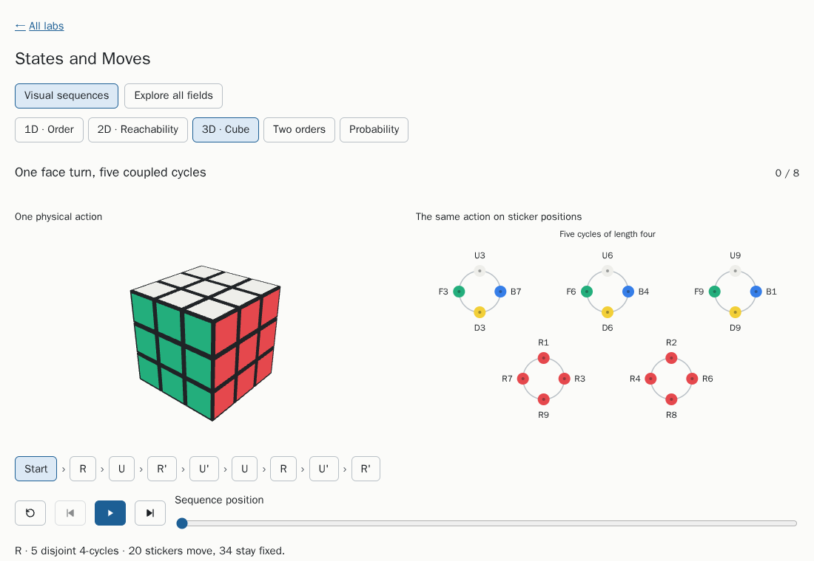
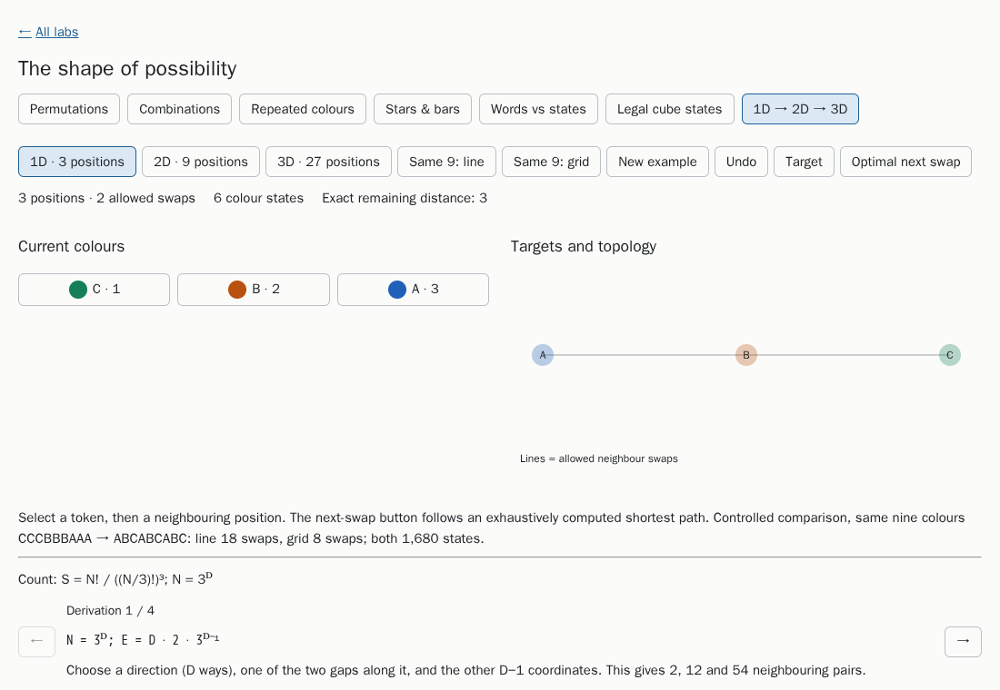
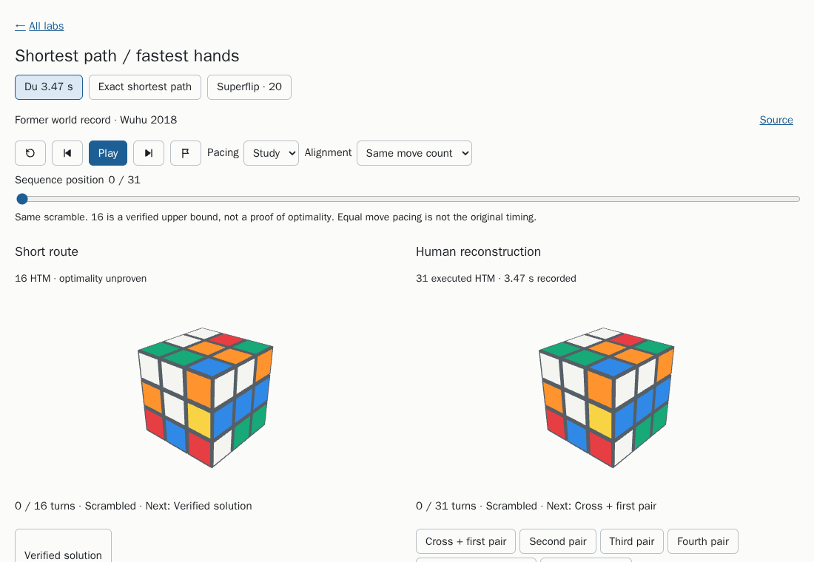

# Interactive Visual Intuitions

Interactive browser labs that build intuition for elementary mathematics: counting and arrangements, the order of actions, routes between states, and chance. They are made for curious secondary-school learners and their teachers: every idea is something you can change and watch, with a plain-language explanation beside it. The pages run offline in any modern browser, straight from disk.

## Intended use

- **Learners** open a lab, change the inputs and watch what happens, with the reasoning written beside each view.
- **Teachers** use a lab in class or set it as homework; everything runs offline from a folder, with no accounts, tracking or network access.
- **Developers** can reuse the patterns: exact models with unit tests behind every visual, and browser tests for the interactions.

## The labs

### States and Moves

Six short chapters: counting arrangements, clock arithmetic, why the order of two moves matters, shortest routes between states, things that never change (such as sliding-puzzle parity), and chance as a random walk whose probabilities always add to 1. It opens with five animated stories that show a physical action and its structure on one playhead, and a reading companion follows along below the explorer.



### The Shape of Possibility

Count permutations, combinations, arrangements with repeated colours, and "stars and bars" groupings, each with a step-by-step derivation. Then rearrange coloured tokens on a line, a 3 × 3 grid and a 3 × 3 × 3 block, and see how the shape of the board changes the number of swaps needed.



### Cube paths and permutations

Three cases, each played as two routes side by side on two cubes from the same starting position: a recorded speedsolve against a much shorter computed route, a four-turn shortest solution against a familiar trigger repeated five times, and the Superflip position with its proven 20-turn minimum against a 21-turn computed route. Step through the turns, follow a single piece, and compare the length of a route with what it does to the pieces.



## Quick start

Requirements: Node.js 24.

```sh
npm ci
npm run build
```

Then open `dist/index.html` in a browser. It links the three labs, and each lab links back. No server or network connection is needed. Keep `dist/vendor/` next to the pages if you move them: it holds the copy of Three.js used by the 3D cube views. Where WebGL is unavailable, the cube views fall back to a flat sticker net. Each page saves its settings in this browser's local storage; if storage is blocked, the pages still work but start fresh each time.

`npm run build` runs each lab's build script (fragments go to `output/`) and wraps them in a shared page shell (`scripts/shell.html`) as standalone pages in `dist/`. Both folders are generated and ignored by git.

To refresh the screenshots above after a build: `node scripts/capture-screenshots.cjs`.

## Tests

The browser tests need Playwright's Chromium once per machine: `npx playwright install chromium` (on Linux, add `--with-deps` for the system libraries). Then:

```sh
npm test
```

runs two groups:

- `npm run test:unit`: Node checks of the mathematics: cube geometry and the stored solutions, the counting and swap-distance model of The Shape of Possibility, and the States and Moves model and visual sequences.
- `npm run test:browser`: builds `dist/`, then opens the pages from `file://` in headless Chromium with HTTP(S) requests blocked:
  - the start page: every card opens a built lab without page errors, every lab links back, keyboard order, light and dark schemes, and no horizontal overflow at 320 and 1100 pixels;
  - the four lab suites: every view at desktop and phone widths, playback and other controls, extreme settings, labels kept inside their drawings, light and dark schemes, reduced motion, saved-state restore, and the flat fallback when Three.js cannot load (each lab's README lists its own checks).

Every suite fails on any page error, prints `PASS` or `FAIL`, and writes a result file and screenshots to `output/browser/<suite>/`. CI (`.github/workflows/ci.yml`) runs `npm test` on every push and pull request and uploads `output/` when a run fails.

## Project layout

- `scripts/`: the page shell, the build (`build.mjs`), the shared browser-test harness, the start-page test and the screenshot script.
- `artifacts/states-and-moves/`, `artifacts/possibility-atlas/`, `artifacts/cube-permutation-study/`: one folder per lab with its model, page template, build script, tests and a README on sources, data and limits.
- `docs/images/`: README screenshots.

## Roadmap

Planned labs (fractions and ratios, straight-line graphs, chance experiments, area and volume) and improvements are listed in [ROADMAP.md](ROADMAP.md).

## Status

Three labs are complete and tested in CI on every push. Planned work is in [ROADMAP.md](ROADMAP.md).

## Ownership and contributors

This is an independent personal project by Han ([MetaCortex728](https://github.com/MetaCortex728)). It is not owned by, or developed for, any employer, client, university or other organization, and no one else currently works on the repository.

## Project history

Han developed these studies locally in October 2026 with OpenAI Codex as a coding assistant, without version control. This repository continues from that local snapshot (2026-10-28 sources), scoped down to elementary material. The first commit imports the sources as they were, except for files that could not be redistributed here: HTML exports from the original host renderer, the GPL-3.0 min2phase.js solver (see [License](#license)), and screenshots and a delivery record tied to the original machine. Later commits trimmed the labs to an elementary scope, rewrote them in plain language, and replaced the original host page with this repository's own page shell and build. Work in this repository, from November 2026, was planned and reviewed by Han with Anthropic's Claude as a coding assistant.

## License

Licensed under the Apache License, Version 2.0; see `LICENSE`. Third-party notices are in `NOTICE`. The built pages include Three.js (MIT), copied from npm into `dist/vendor/three/` with its licence.

The cube study's two stored solver results (the 16-move route for the Du scramble and the 21-turn two-phase result for Superflip) were computed once with [min2phase.js](https://github.com/cs0x7f/min2phase.js) by Chen Shuang (GPL-3.0). That solver is not included in this repository and is not required to build or test it; the build scripts read the stored solutions from `artifacts/cube-permutation-study/prepared.json` and verify that each one solves its scramble.
